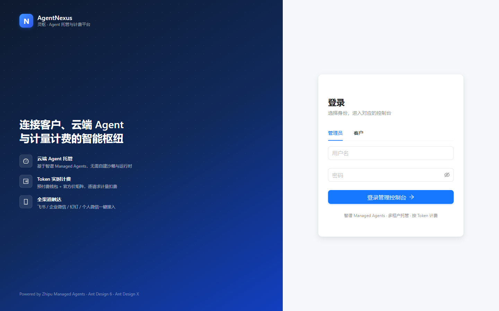
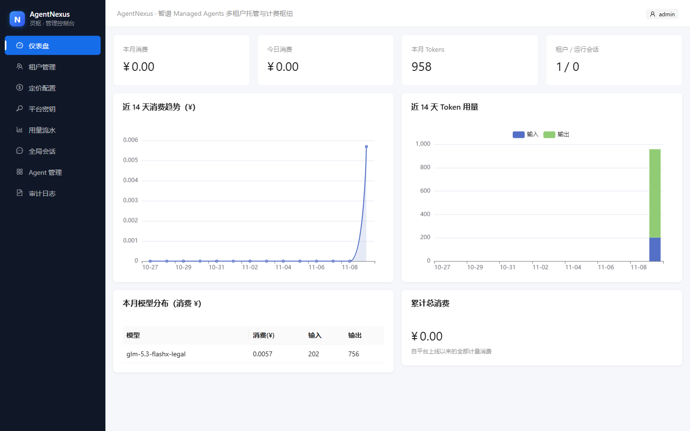
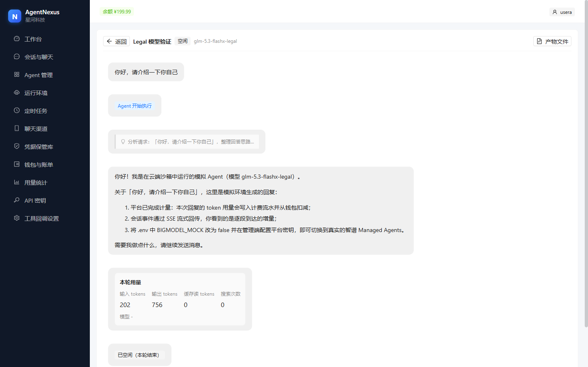
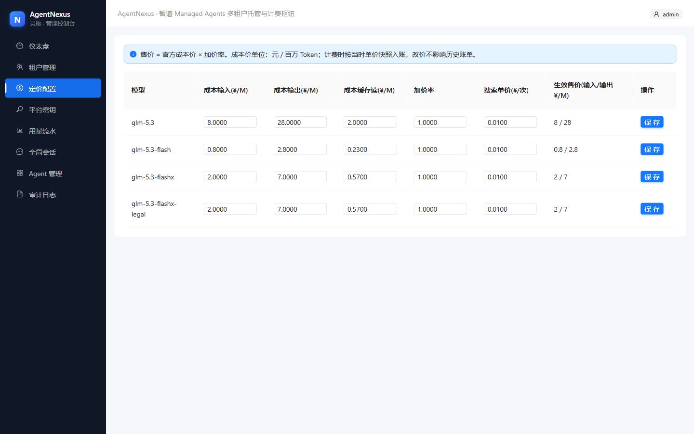
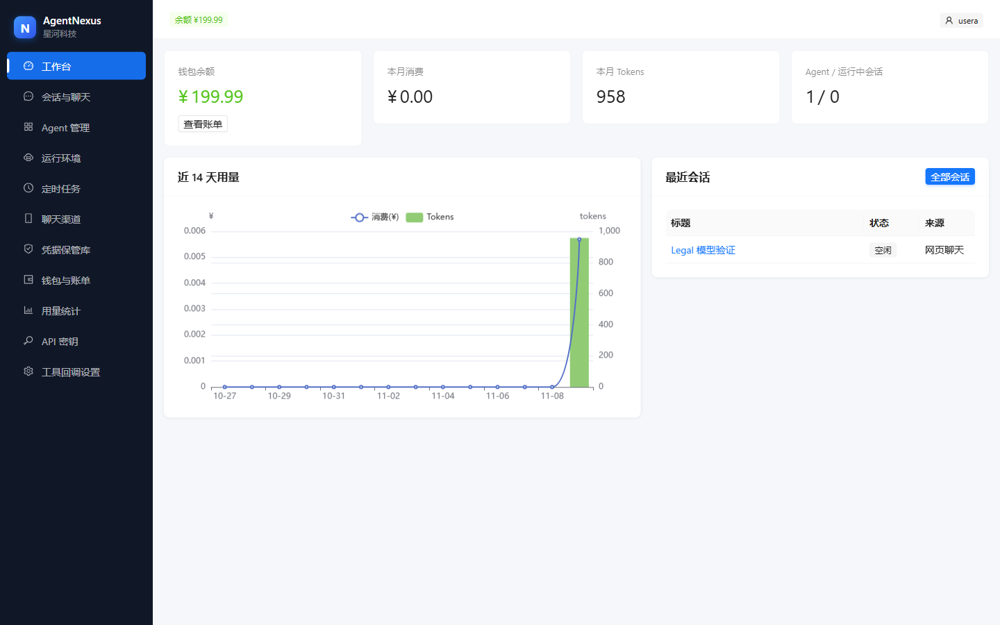
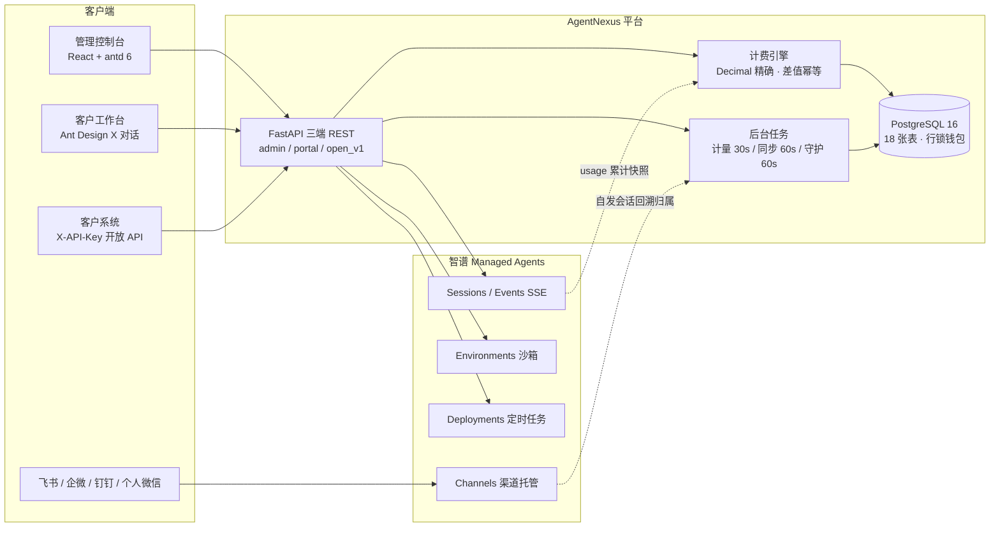

<div align="center">

# AgentNexus · 灵枢

**连接客户、云端 Agent 与计量计费的智能枢纽**

基于智谱开放平台 Managed Agents 的多租户 Agent 托管与计费平台

[](https://fastapi.tiangolo.com)
[](https://react.dev)
[](https://ant.design)
[](https://x.ant.design)
[](https://www.postgresql.org)
[](https://docs.docker.com/compose)
[](#license)

*登录页 — 品牌 / 表单双栏布局*


</div>

---

## 这是什么

AgentNexus 面向「向客户提供托管 Agent 服务」的运营方：

- **管理员** 租户生命周期、钱包充值、按模型定价（官方成本价 × 加价率）、平台密钥托管、全局用量审计
- **客户（租户）** 自助创建 Agent 与运行环境、Web 流式对话、定时任务、聊天渠道接入、账单明细
- **计费引擎** 上游累计用量做差结算，Decimal 精确到 6 位小数，欠费自动停服、充值自动恢复

> 上游对接 [智谱 Managed Agents](https://docs.bigmodel.cn/cn/managed-agents/overview)（`zai-version: 2026-05-26` + `zai-beta: managed-agents-2026-09-22`）。内置 Mock 上游，无真实 API Key 也可完整演示全流程。

## 截图

| | |
|---|---|
|  |  |
| **管理控制台仪表盘**：消费趋势 / Token 用量 / 模型分布 | **AI 对话**：Bubble.List 气泡流 + XMarkdown 流式渲染 + A2UI 动态用量卡 |
|  |  |
| **定价矩阵**：官方成本价预填，加价率实时联动售价 | **客户工作台**：余额 / 本月消费 / 用量趋势 |

## 架构



**数据流（计费闭环）**：会话详情 `usage` 为累计快照 → 平台「查询即对账 + 30s 轮询兜底」做差 → 同一事务内写入计费流水（单价快照随行）并扣减钱包（行锁）→ 余额低于阈值触发守护任务暂停定时任务，充值后自动恢复。

## 官方价格矩阵（内置预填）

来源 [智谱开放平台定价页](https://docs.bigmodel.cn/cn/guide/start/pricing)（2026-11 查询），seed 自动写入，可在管理端调整加价率：

| 模型 | 输入 (¥/M tokens) | 输出 (¥/M tokens) | 缓存读 (¥/M tokens) | Web Search (¥/次) |
|---|---:|---:|---:|---:|
| GLM-5.3 | 8.00 | 28.00 | 2.00 | 0.01 (Search-Std) |
| GLM-5.3-Flash | 0.80 | 2.80 | 0.23 | 0.01 |
| GLM-5.3-FlashX | 2.00 | 7.00 | 0.57 | 0.01 |
| GLM-5.3-FlashX-Legal（法律专用） | 2.00 | 7.00 | 0.57 | 0.01 |

> 客户售价 = 官方成本价 × 加价率（默认 1.0）；计费时按当时单价快照入流水，改价不影响历史账单。缓存存储与沙箱费用当前限时免费，以官方公告为准。

## 功能矩阵

| 模块 | 管理控制台 | 客户工作台 | 开放 API |
|---|:-:|:-:|:-:|
| 仪表盘（消费 / Token 趋势） | ✓ | ✓ | — |
| 租户管理 + 钱包充值 / 调整 | ✓ | — | — |
| 定价配置（成本 × 加价率） | ✓ | — | — |
| 平台密钥（Fernet 加密，可绑定租户） | ✓ | — | — |
| Agent 管理（版本历史 / MCP / 自定义工具） | 只读 | ✓ | 只读 |
| 运行环境（apt / pip / npm + 网络白名单） | — | ✓ | 只读 |
| 会话与流式对话 | 全局视图 | ✓ | ✓（SSE） |
| 定时任务（cron + 手动触发 + 运行记录） | — | ✓ | ✓ |
| 聊天渠道（4 官方渠道 + 微信扫码绑定） | — | ✓ | — |
| 凭据保管库（MCP / OAuth / 环境变量，只写不读） | — | ✓ | — |
| 钱包账单（流水 / 月度账单 / CSV 导出） | 全局 | ✓ | 查询 |
| 计量流水 + 单价快照 | ✓ | ✓ | ✓ |
| 欠费守护（402 拦截 + 定时任务自动暂停 / 恢复） | ✓ | 通知 | ✓ |

## 快速开始

```bash
cp .env.example .env          # 默认 BIGMODEL_MOCK=true，无需真实 API Key
docker compose up -d --build
open http://localhost:8080    # 管理员默认 admin / admin123456
```

**五分钟体验路径**：

1. 管理员登录 → 新建租户（勾选门户账号，赠送 ¥200）→ 查看「定价配置」中预填的官方价矩阵
2. 客户登录 → 创建运行环境与 Agent（可选 `glm-5.3-flashx-legal` 法律专用模型）→ 新建会话进入对话页
3. 发送消息，观察流式回复、工具调用卡与每轮 **A2UI 动态用量卡片**；钱包余额实时扣减
4. 「API 密钥」创建 Key，程序化接入：

```bash
curl -X POST http://localhost:8080/api/open/v1/sessions \
  -H "X-API-Key: ak-xxx" -H "Content-Type: application/json" \
  -d '{"agent_id":"<Agent ID>","environment_id":"<环境 ID>","initial_message":"你好"}'

curl -X POST http://localhost:8080/api/open/v1/sessions/<id>/messages \
  -H "X-API-Key: ak-xxx" -H "Content-Type: application/json" -d '{"text":"问题"}'

curl -N http://localhost:8080/api/open/v1/sessions/<id>/events/stream -H "X-API-Key: ak-xxx"
```

5. 「聊天渠道」创建个人微信渠道体验扫码绑定；「定时任务」手动触发查看运行记录

**切换真实上游**：`.env` 中 `BIGMODEL_MOCK=false`，管理端「平台密钥」录入 BigModel API Key。

## 技术栈

| 层 | 选型 | 说明 |
|---|---|---|
| 后端 | FastAPI + SQLAlchemy 2.0 (async) + APScheduler | 三端 REST，内嵌周期任务 |
| 数据库 | PostgreSQL 16 | 金额一律 Numeric + Decimal(18,6) |
| 前端 | React 19 + Ant Design 6 | 遵循 [ant.design/design.md](https://ant.design/design.md) 设计体系 |
| AI 对话 | Ant Design X 2.10 | Bubble.List / Sender / XMarkdown / XCard (A2UI) / XStream |
| 图表 | ECharts | 消费趋势、Token 用量、模型分布 |
| 部署 | Docker Compose | postgres + backend + frontend(nginx)，nginx 对 SSE 关闭缓冲 |

## 项目结构

```
backend/app
├── api/admin|portal|open_v1/   # 三端 REST API
├── services/bigmodel/          # 上游客户端（real httpx + mock + 工厂按租户选 Key）
├── services/                   # billing 计费 · metering 计量 · sync 同步 · guard 守护 · toolforward 工具回调
├── workers/scheduler.py        # APScheduler：计量 30s / 同步 60s / 守护 60s
├── models.py                   # 18 张表（租户/钱包/流水/计费/会话/渠道/审计…）
└── seed.py                     # 幂等种子（管理员 + 官方价格矩阵）
frontend/src
├── api/                        # axios 封装 + XStream SSE（fetch 流式）
├── layouts/ views/             # antd v6 页面（管理端 9 + 门户 12）
└── components/                 # BrandMark 品牌标 · UsageCard（XCard A2UI 用量卡）
```

## 验证

```bash
# 单元测试（计费 Decimal 精度 / 差值幂等 / 安全模块）
cd backend && python -m pytest tests/test_billing.py tests/test_security.py -q

# 端到端冒烟（SQLite + Mock 上游，15 步全链路）
cd backend && python tests/smoke_e2e.py
```

冒烟覆盖：管理员登录 → 建租户充值 → 定价 → 门户建环境 / Agent → 会话对话 → 计量扣款 → 事件历史 → 开放 API 全链路 → 定时任务触发 → 微信扫码绑定 → 欠费封锁（402 + 定时任务暂停）→ 充值自动恢复。

## 已知边界（v1）

- 渠道 / 定时任务自发创建的会话依赖同步任务归属（≤60s 延迟）
- 渠道侧不支持自定义工具人工接续（上游限制），请使用内置工具或租户工具回调（HMAC-SHA256 签名转发）
- 计量 / 守护任务为单实例内嵌调度，多副本部署时仅保留一个 `WORKER_ENABLED=true` 实例

## License

MIT
